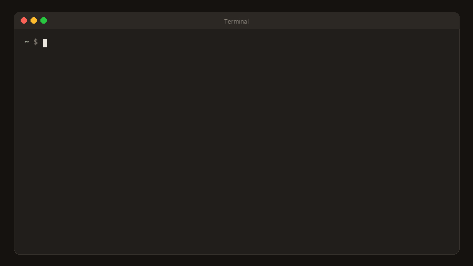
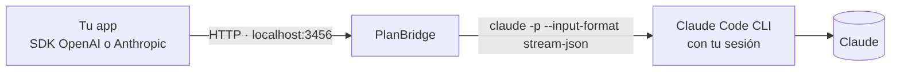

<div align="center">

# PlanBridge

**Tu suscripción de Claude Code como una API local para las apps, scripts y webs que creas para ti.**

Compatible con OpenAI · Compatible con Anthropic · imágenes, PDFs, sesiones, JSON · cero dependencias

[English](README.md) · [Español](README.es.md)

</div>



---

Ya pagas Claude Pro o Max y tienes Claude Code instalado. PlanBridge deja que tus propios proyectos usen ese mismo Claude, con el formato de API que ya entiende cualquier herramienta:

```python
from openai import OpenAI
ai = OpenAI(base_url="http://127.0.0.1:3456/v1", api_key="pb-…")   # ← planbridge key

print(ai.chat.completions.create(
    model="sonnet",
    messages=[{"role": "user", "content": "Escribe un haiku sobre localhost"}],
).choices[0].message.content)
```

No necesitas comprar una API key ni pagar nada extra: cada petición ejecuta el CLI oficial `claude` en tu ordenador, con tu sesión.

> [!IMPORTANT]
> **Solo para uso personal.** Tu suscripción cubre *tu* uso. Los términos de Anthropic no permiten dar servicio a otras personas con ella, revenderla ni meter tu login en apps que usen otros. PlanBridge escucha solo en `127.0.0.1` y nunca toca tus credenciales. Si publicas algo para otra gente, apunta el mismo código a una API key de Anthropic ([ver abajo](#publicar-una-app)). Es un proyecto comunitario no oficial, sin relación con Anthropic.

## Instalar

Necesitas **Node 21.7+** y **[Claude Code](https://claude.com/claude-code)** con sesión iniciada (ejecuta `claude` una vez).

```bash
npm install -g planbridge
planbridge start
```

O sin instalar nada: `npx planbridge start`.

Si prefieres el instalador de una línea (instala Claude Code si falta y configura el skill):

```bash
# macOS / Linux
curl -fsSL https://raw.githubusercontent.com/CalaKuad1/planbridge/main/scripts/install.sh | sh
```
```powershell
# Windows (PowerShell)
irm https://raw.githubusercontent.com/CalaKuad1/planbridge/main/scripts/install.ps1 | iex
```

Después:

```bash
planbridge open             # playground en el navegador
planbridge key              # tu API key local
planbridge autostart on     # que arranque solo al iniciar sesión
```

## Úsalo desde cualquier sitio

| Usas… | Apunta a |
|---|---|
| **SDK de OpenAI** (Python, JS, Go…) | `base_url = http://127.0.0.1:3456/v1`, `api_key = $(planbridge key)` |
| **SDK de Anthropic** | `base_url = http://127.0.0.1:3456`, `api_key = $(planbridge key)` |
| **Una página web sin build** | `<script src="http://127.0.0.1:3456/sdk.js">` |
| **curl / scripts** | `POST /v1/chat/completions` |
| **Open WebUI, LibreChat, n8n, Continue, Raycast…** | proveedor "OpenAI compatible" con la base URL de arriba |

`planbridge env` te imprime las variables de entorno listas para pegar.

```html
<script src="http://127.0.0.1:3456/sdk.js"></script>
<script>
  const ai = new PlanBridge({ apiKey: 'pb-…' });
  await ai.ask('¡Hola!');                                           // → texto
  await ai.ask('¿Qué hay en la foto?', { images: [file] });         // File, Blob, data URL o URL
  await ai.ask('Cuéntame un cuento', { onText: (t, todo) => (el.textContent = todo) });  // streaming
  const chat = ai.chat({ system: 'Eres un pirata' });              // recuerda la conversación
  await chat.send('Hola'); await chat.send('¿Qué te acabo de decir?');
  await ai.json('Una fruta roja', { type: 'object', properties: { nombre: { type: 'string' } }, required: ['nombre'] });
</script>
```

Tienes un chat completo en un solo archivo en [`examples/web-chat.html`](examples/web-chat.html).

## Que Claude lo integre por ti

PlanBridge incluye un **skill para Claude Code**. Con el skill instalado, si le pides *"añade un asistente de IA a mi app de notas"*, Claude Code comprueba que PlanBridge está en marcha, guarda la key en `.env`, escribe la integración con streaming y manejo de errores, y elige el modelo adecuado para cada función.

```bash
planbridge skill install
```

O como plugin, desde Claude Code:

```
/plugin install planbridge --marketplace CalaKuad1/planbridge
```

**¿Sin skill? Pega este prompt:**

```text
Añade funciones de IA a esta app usando PlanBridge: mi API local de Claude en http://127.0.0.1:3456
(compatible con OpenAI en /v1, con Anthropic en /v1/messages, SDK de navegador en /sdk.js).
Obtén la key con `planbridge key` y guárdala en .env (en .gitignore), nunca en código commiteado.
Lee las variables AI_BASE_URL / AI_API_KEY / AI_MODEL para que pueda cambiar a una API key de Anthropic más adelante.
Haz streaming, muestra un estado de carga y maneja "no está en marcha" (dime que ejecute `planbridge start`),
y los errores 401 y 429. Usa haiku para tareas rápidas, sonnet por defecto y opus para las difíciles.
Referencia: https://github.com/CalaKuad1/planbridge/blob/main/skills/planbridge/SKILL.md
```

## Qué funciona

| | |
|---|---|
| 💬 Texto + streaming | SSE de OpenAI y de Anthropic |
| 🖼️ Imágenes | data URLs, URLs `http(s)` (las descarga el servidor), bloques nativos de Anthropic |
| 📄 PDFs y archivos de texto | partes `file`: PDF, txt, md, csv, json, código… |
| 🧠 Conversaciones | envías el historial completo (sin estado) **o** pasas `session_id` y solo el mensaje nuevo |
| 🧩 Salida estructurada | `response_format: json_schema` (validado, también llega como `parsed`) o `json_object` |
| 🤔 Esfuerzo de razonamiento | `reasoning_effort: low … max`; los tokens de thinking salen en `usage` |
| 🎛️ Modelos | `sonnet`, `opus`, `haiku`, `fable` o ids completos como `claude-opus-5-5` |
| 📊 Uso del plan | `GET /v1/limits` y `planbridge status` muestran tu uso de las ventanas de 5 h y 7 días |
| ⚡ Procesos precalentados | deja un proceso de Claude Code arrancado para tu siguiente petición: primer token en ~1,5 s en vez de ~2,5 s |
| 🛡️ Protecciones | key local, solo localhost, 2 en paralelo / 30 por minuto por defecto, timeouts, cancela si el cliente se va |

**No soportado:** function calling / `tools`, `temperature` / `top_p` / `max_tokens` (se ignoran), embeddings, generar imágenes, ni el *texto* del razonamiento (Claude Code no lo devuelve). El primer token llega en unos 1,5 s (unos 2,5 s tras una pausa). Las peticiones gastan de los límites normales de tu plan.

La memoria, la búsqueda web y los agentes se dejan a propósito a cada app, para que cada una los haga a su manera. El skill le enseña a Claude cómo hacerlos: un bucle de agente con salida estructurada, memoria en la app y pasarle resultados de búsqueda ([snippets](skills/planbridge/references/snippets.md)).

## CLI

| Comando | |
|---|---|
| `planbridge start [--port 3456]` | arranca el servidor |
| `planbridge status` | ¿está en marcha? + barras de uso del plan |
| `planbridge open` | abre el playground |
| `planbridge key [--rotate]` | muestra o regenera tu key |
| `planbridge env` | variables de entorno para tus apps |
| `planbridge doctor [--deep]` | revisa Node, la versión y la sesión de Claude Code, el servidor y el skill; `--deep` hace una petición real mínima por todo el sistema |
| `planbridge skill install [--project]` | instala el skill de Claude Code |
| `planbridge autostart on\|off` | arranque al iniciar sesión (Programador de tareas / launchd / systemd) |
| `planbridge stop` | para el servidor |

## Cómo funciona



Por cada petición, PlanBridge convierte los mensajes y ejecuta el binario `claude` **sin modificar** en modo headless:

- con `--tools ""`, para que actúe como un modelo normal, sin acceso a archivos ni a la terminal;
- con `--safe-mode`, para que no cargue tus hooks, plugins, MCP ni CLAUDE.md;
- con tu system prompt en lugar del de Claude Code;
- con `--session-id` / `--resume` para conversaciones, o `--no-session-persistence` si es sin estado.

Luego traduce la salida `stream-json` al formato de OpenAI o de Anthropic. Nunca lee, guarda ni reenvía tus credenciales.

## Configuración

Opcional, en `~/.planbridge/.env` (ver [`.env.example`](.env.example)): puerto, host, key, modelo y esfuerzo por defecto, system prompt por defecto, concurrencia (2), cola (20), peticiones por minuto (30), timeout, tamaño máximo (25 MB), procesos precalentados (`WARM_POOL=2`), borrado de conversaciones inactivas (`SESSION_TTL_DAYS=30`), CORS y ruta a `claude`.

## Publicar una app

Cuando una app vaya a usarla otra gente, mantén el código y cambia tres variables. Anthropic ofrece un endpoint compatible con OpenAI:

| | Personal (PlanBridge) | Público (API de Anthropic) |
|---|---|---|
| Base URL | `http://127.0.0.1:3456/v1` | `https://api.anthropic.com/v1/` |
| Key | `planbridge key` | una key de [platform.claude.com](https://platform.claude.com) |
| Modelo | `sonnet` | `claude-sonnet-5-5` |

## Preguntas frecuentes

**¿Está permitido?**
El modo headless de Claude Code (`claude -p`) es una función oficial y documentada, y la [página legal](https://code.claude.com/docs/en/legal-and-compliance) de Anthropic dice que los límites de los planes *"asumen un uso ordinario e individual de Claude Code y del Agent SDK"*. Lo que **no** se permite es pasar peticiones de otras personas por tu plan, ofrecer login de Claude.ai en tu producto, o recoger o intermediar credenciales. PlanBridge está diseñado para quedarse en el lado correcto: solo localhost, binario oficial, tu sesión, sin tocar credenciales. Si lo usas de forma masiva o lo expones a otros, es cosa tuya. Lee los términos y decide.

**¿En qué se diferencia de otros proxies?**
[claude-max-api-proxy](https://github.com/wende/claude-max-api-proxy) y [claude-cli-proxy](https://github.com/SenZhangAI/claude-cli-proxy) abrieron el camino. PlanBridge añade imágenes, PDFs y archivos, sesiones en servidor, JSON con esquema, endpoint Anthropic, SDK de navegador, uso del plan, aislamiento de tu configuración, autoarranque y un skill de Claude Code. Y no tiene dependencias.

**¿Por qué tarda más el primer token?**
Claude Code hace algo de trabajo de arranque en cada petición. El pool de procesos precalentados oculta la mayor parte: de 2,49 s a 1,50 s sin sesión y de 2,44 s a 1,68 s con sesión. Cada proceso en espera usa ~240 MB; se configura con `WARM_POOL` (0 lo desactiva).

## Desarrollo

```bash
git clone https://github.com/CalaKuad1/planbridge && cd planbridge
npm start        # desde el código
npm test         # tests unitarios y de integración, ~6 s, sin cuenta de Claude (usa un CLI falso)
npm run smoke    # pruebas de extremo a extremo con el servidor en marcha
```

## Licencia

[MIT](LICENSE). "Claude" y "Claude Code" son marcas de Anthropic, PBC; aquí solo se usan para describir con qué funciona la herramienta.
