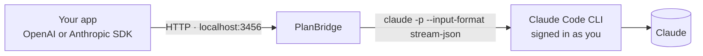

<div align="center">

# PlanBridge

**Your Claude Code subscription as a local API for the apps, scripts and sites you build for yourself.**

OpenAI-compatible · Anthropic-compatible · images, PDFs, sessions, JSON · zero dependencies

[](https://github.com/CalaKuad1/planbridge/actions/workflows/ci.yml)
[](https://github.com/CalaKuad1/planbridge/actions/workflows/claude-code-compat.yml)


[English](README.md) · [Español](README.es.md)

</div>

---

You already pay for Claude Pro or Max and you have Claude Code installed. PlanBridge lets your own projects use that same Claude, through the API shape every tool already speaks:

```python
from openai import OpenAI
ai = OpenAI(base_url="http://127.0.0.1:3456/v1", api_key="pb-…")   # ← planbridge key

print(ai.chat.completions.create(
    model="sonnet",
    messages=[{"role": "user", "content": "Write a haiku about localhost"}],
).choices[0].message.content)
```

No API key to buy, no extra bill: each request runs the official `claude` CLI on your machine, signed in as you.

> [!IMPORTANT]
> **Personal use only.** A Claude subscription covers *your own* use. Anthropic's terms don't allow serving other people with it, reselling it, or putting your login inside apps others use. PlanBridge listens on `127.0.0.1` only and never touches your credentials. If you ship something to other people, point the same code at an Anthropic API key ([see below](#going-public)). PlanBridge is an unofficial community project, not affiliated with or endorsed by Anthropic.

## Install

You need **Node 21.7+** and **[Claude Code](https://claude.com/claude-code)**, logged in (run `claude` once).

```bash
npm install -g github:CalaKuad1/planbridge
planbridge start
```

Or with the one-line installer, which also installs Claude Code if it's missing and sets up the skill:

```bash
# macOS / Linux
curl -fsSL https://raw.githubusercontent.com/CalaKuad1/planbridge/main/scripts/install.sh | sh
```
```powershell
# Windows (PowerShell)
irm https://raw.githubusercontent.com/CalaKuad1/planbridge/main/scripts/install.ps1 | iex
```

Then:

```bash
planbridge open             # playground in your browser
planbridge key              # your local API key
planbridge autostart on     # start it automatically when you log in
```

## Use it from anything

| You use… | Point it at |
|---|---|
| **OpenAI SDK** (Python, JS, Go…) | `base_url = http://127.0.0.1:3456/v1`, `api_key = $(planbridge key)` |
| **Anthropic SDK** | `base_url = http://127.0.0.1:3456`, `api_key = $(planbridge key)` |
| **A plain web page** | `<script src="http://127.0.0.1:3456/sdk.js">` |
| **curl / shell scripts** | `POST /v1/chat/completions` |
| **Open WebUI, LibreChat, n8n, Continue, Raycast…** | "OpenAI-compatible" provider with the base URL above |

`planbridge env` prints ready-to-paste environment variables.

<details>
<summary><b>JavaScript (OpenAI SDK)</b></summary>

```js
import OpenAI from 'openai';
const ai = new OpenAI({ baseURL: 'http://127.0.0.1:3456/v1', apiKey: process.env.PLANBRIDGE_API_KEY });

const stream = await ai.chat.completions.create({
  model: 'sonnet',
  stream: true,
  messages: [{ role: 'user', content: 'Explain CRDTs like I am five' }],
});
for await (const chunk of stream) process.stdout.write(chunk.choices[0]?.delta?.content || '');
```
</details>

<details>
<summary><b>Anthropic SDK</b></summary>

```js
import Anthropic from '@anthropic-ai/sdk';
const claude = new Anthropic({ baseURL: 'http://127.0.0.1:3456', apiKey: process.env.PLANBRIDGE_API_KEY });
const msg = await claude.messages.create({ model: 'sonnet', max_tokens: 1024, messages: [{ role: 'user', content: 'Hi!' }] });
```
</details>

<details>
<summary><b>Browser, no build step</b></summary>

```html
<script src="http://127.0.0.1:3456/sdk.js"></script>
<script>
  const ai = new PlanBridge({ apiKey: 'pb-…' });

  await ai.ask('Hello!');                                            // → string
  await ai.ask('What is in this photo?', { images: [file] });        // File, Blob, data URL or URL
  await ai.ask('Tell me a story', { onText: (t, all) => (el.textContent = all) });   // streaming

  const chat = ai.chat({ system: 'You are a pirate' });              // remembers the conversation
  await chat.send('Hi');  await chat.send('What did I just say?');

  await ai.json('A red fruit', { type: 'object', properties: { name: { type: 'string' } }, required: ['name'] });
</script>
```

A complete one-file chat app is in [`examples/web-chat.html`](examples/web-chat.html).
</details>

<details>
<summary><b>curl</b></summary>

```bash
curl http://127.0.0.1:3456/v1/chat/completions \
  -H "Authorization: Bearer $(planbridge key)" -H "Content-Type: application/json" \
  -d '{"model":"haiku","messages":[{"role":"user","content":"Hello"}]}'
```
</details>

## Let Claude wire it in for you

PlanBridge ships a **Claude Code skill**. With it installed, when you ask Claude Code to *"add an AI assistant to my notes app"*, it checks that PlanBridge is running, stores the key in `.env`, writes the integration with streaming and error handling, and picks the right model for each feature.

```bash
planbridge skill install
```

Or as a plugin, from inside Claude Code:

```
/plugin install planbridge --marketplace CalaKuad1/planbridge
```

<details>
<summary><b>No skill? Paste this prompt instead</b></summary>

```text
Add AI features to this app using PlanBridge: my local Claude API at http://127.0.0.1:3456
(OpenAI-compatible at /v1, Anthropic-compatible at /v1/messages, browser SDK at /sdk.js).
Get the key with `planbridge key` and keep it in .env (gitignored), never in committed code.
Read the AI_BASE_URL / AI_API_KEY / AI_MODEL env vars so I can switch to an Anthropic API key later.
Stream responses, show a loading state, and handle "not running" (tell me to run `planbridge start`),
401 and 429 errors. Use haiku for quick tasks, sonnet by default, opus for hard ones.
Reference: https://github.com/CalaKuad1/planbridge/blob/main/skills/planbridge/SKILL.md
```
</details>

## What works

| | |
|---|---|
| 💬 Text + streaming | OpenAI SSE and Anthropic SSE |
| 🖼️ Images | data URLs, `http(s)` URLs (downloaded for you), native Anthropic blocks |
| 📄 PDFs and text files | `file` parts: PDF, txt, md, csv, json, code… |
| 🧠 Conversations | send the full history (stateless) **or** pass `session_id` and send only the new message |
| 🧩 Structured output | `response_format: json_schema` (validated, also returned as `parsed`) or `json_object` |
| 🤔 Thinking effort | `reasoning_effort: low … max`; thinking tokens reported in `usage` |
| 🎛️ Models | `sonnet`, `opus`, `haiku`, `fable` or full ids like `claude-opus-5-5` |
| 📊 Plan usage | `GET /v1/limits` and `planbridge status` show your 5-hour and 7-day usage |
| ⚡ Warm pool | keeps a Claude Code process pre-started for your next request: first token in ~1.5 s instead of ~2.5 s |
| 🛡️ Guard rails | local key, localhost-only, 2 parallel / 30 per minute by default, timeouts, cancels on disconnect |

**Not supported:** function calling / `tools`, `temperature` / `top_p` / `max_tokens` (ignored), embeddings, image generation, and the *text* of the model's thinking (Claude Code doesn't return it). The first token arrives in about 1.5 s (about 2.5 s after a pause). Requests use your plan's normal limits.

Memory, web search and agents are intentionally left to your app, so each app can do them its own way. The skill teaches Claude the patterns: a structured-output agent loop, app-side memory, and passing in search results ([snippets](skills/planbridge/references/snippets.md)).

## CLI

| Command | |
|---|---|
| `planbridge start [--port 3456]` | run the server |
| `planbridge status` | running? + plan usage bars |
| `planbridge open` | open the playground |
| `planbridge key [--rotate]` | print or regenerate your local key |
| `planbridge env` | env vars for your apps |
| `planbridge doctor [--deep]` | check Node, Claude Code version and login, server and skill; `--deep` sends one tiny real request through the whole pipeline |
| `planbridge skill install [--project]` | install the Claude Code skill |
| `planbridge autostart on\|off` | start at login (Task Scheduler / launchd / systemd) |
| `planbridge stop` | stop the server |

## How it works



For every request PlanBridge converts the messages, then runs the **unmodified** `claude` binary in headless mode with:

- `--tools ""` so it acts as a plain model (no file or shell access);
- `--safe-mode` so your hooks, plugins, MCP servers and CLAUDE.md are not loaded;
- your system prompt instead of Claude Code's;
- `--session-id` / `--resume` for conversations, or `--no-session-persistence` when stateless.

After each request it starts the process the *next* request will most likely need (same model and system prompt, or the next turn of that conversation) and keeps it waiting on stdin. Measured on Windows with `haiku`, median time to first token went from 2.49 s to 1.50 s for stateless calls and from 2.44 s to 1.68 s for sessions.

It translates the CLI's `stream-json` output back to OpenAI or Anthropic format. PlanBridge never reads, stores or forwards your Claude credentials; the CLI handles its own login.

## Configuration

Optional, in `~/.planbridge/.env` (see [`.env.example`](.env.example)):

| Variable | Default | |
|---|---|---|
| `PLANBRIDGE_PORT` / `PLANBRIDGE_HOST` | `3456` / `127.0.0.1` | |
| `PLANBRIDGE_API_KEY` | generated | stored in `~/.planbridge/api-key.txt` |
| `DEFAULT_MODEL` / `DEFAULT_EFFORT` | `sonnet` / CLI default | |
| `DEFAULT_SYSTEM_PROMPT` | short helpful-assistant prompt | used when a request has no system message |
| `MAX_CONCURRENT` / `MAX_QUEUE` / `RATE_LIMIT_PER_MIN` | `2` / `20` / `30` | protects your plan limits |
| `REQUEST_TIMEOUT_MS` / `MAX_BODY_MB` | `300000` / `25` | |
| `WARM_POOL` / `WARM_TTL_MS` | `2` / `300000` | pre-started processes (~240 MB RAM each, `0` disables) and their idle lifetime |
| `SESSION_TTL_DAYS` | `30` | conversations idle longer than this are deleted, transcripts included (`0` keeps them) |
| `CORS_ORIGIN` | `*` | for local web pages |
| `CLAUDE_BIN` | `claude` | path to Claude Code |

## Going public

When an app is ready for other people, keep the code and change three env vars. Anthropic offers an OpenAI-compatible endpoint:

| | Personal (PlanBridge) | Public (Anthropic API) |
|---|---|---|
| Base URL | `http://127.0.0.1:3456/v1` | `https://api.anthropic.com/v1/` |
| Key | `planbridge key` | a key from [platform.claude.com](https://platform.claude.com) |
| Model | `sonnet` | `claude-sonnet-5-5` |

(`session_id` is PlanBridge-only. Send full message history if the code must run on both.)

## FAQ

**Is this allowed?**
Claude Code's headless mode (`claude -p`) is an official, documented feature, and Anthropic's [legal page](https://code.claude.com/docs/en/legal-and-compliance) says plan limits *"assume ordinary, individual usage of Claude Code and the Agent SDK"*. What's **not** allowed is routing other people's requests through your plan, offering Claude.ai login in your product, or collecting or intermediating Claude credentials. PlanBridge is built to stay on the right side: localhost only, the official binary, your own login, no credential handling. Using it heavily (24/7 batch jobs) or exposing it to others is on you. Read the terms yourself and decide.

**How is this different from other proxies?**
Projects like [claude-max-api-proxy](https://github.com/wende/claude-max-api-proxy) and [claude-cli-proxy](https://github.com/SenZhangAI/claude-cli-proxy) pioneered wrapping the CLI. PlanBridge adds images, PDFs and files, server-side sessions, JSON schema output, an Anthropic-compatible endpoint, a browser SDK, plan-usage reporting, isolation from your Claude Code config, autostart, and a Claude Code skill. It also has zero dependencies.

**Why is the first token slower than the API?**
Claude Code adds some start-up work to each request. The warm pool hides most of it. A request with a new model or system prompt, or the first one after 5 idle minutes, still starts cold.

**Does it use my Claude Code settings or tools?**
No. It runs in safe mode with no tools, in an empty workspace (`~/.planbridge/workspace`).

**Can I use it from my phone or another computer?**
You can bind `PLANBRIDGE_HOST=0.0.0.0` for *your own* devices on a trusted network. PlanBridge warns when you do. Never expose it to the internet.

## Development

```bash
git clone https://github.com/CalaKuad1/planbridge && cd planbridge
npm start            # run from source
npm test             # unit + integration tests, ~6 s, no Claude account needed
npm run smoke        # end-to-end against a running server and your real Claude Code
```

How it is tested:

- **`npm test`** starts the real server against [a fake `claude` CLI](test/fixtures/fake-claude.mjs) that speaks the same `stream-json` protocol. It covers both API formats, streaming, sessions, files, errors, timeouts, limits, disconnects and the warm pool. CI runs it on Windows, macOS and Linux.
- **[Claude Code compatibility](.github/workflows/claude-code-compat.yml)** installs the *latest* Claude Code every week and checks it still accepts every argument set PlanBridge uses.
- **`planbridge doctor --deep`** runs the same check plus one real request on your machine, using your Claude.

PRs welcome: keep it dependency-free and keep the personal-use guard rails. See the [roadmap](#roadmap).

## Roadmap

PlanBridge stays a small, plain model API. Memory, search and agents belong in your app (see the skill).

- [x] Warm process pool for faster first tokens
- [ ] `npx planbridge` on npm
- [ ] Native OpenAI `tools` field (only if agent frameworks need it; the structured-output loop already works)

## License

[MIT](LICENSE). "Claude" and "Claude Code" are trademarks of Anthropic, PBC. They're used here only to describe what this tool works with.
